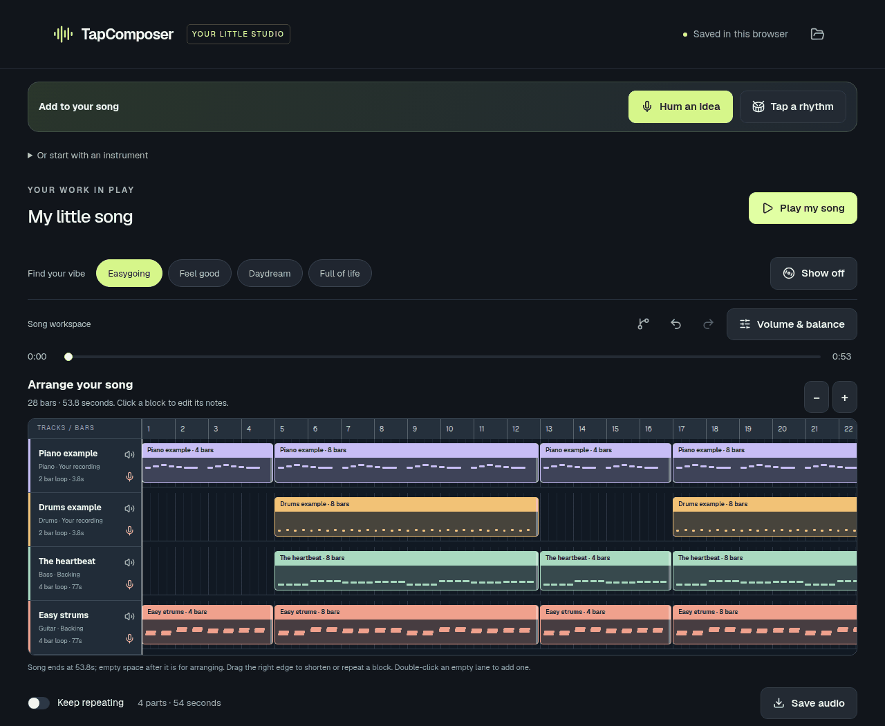
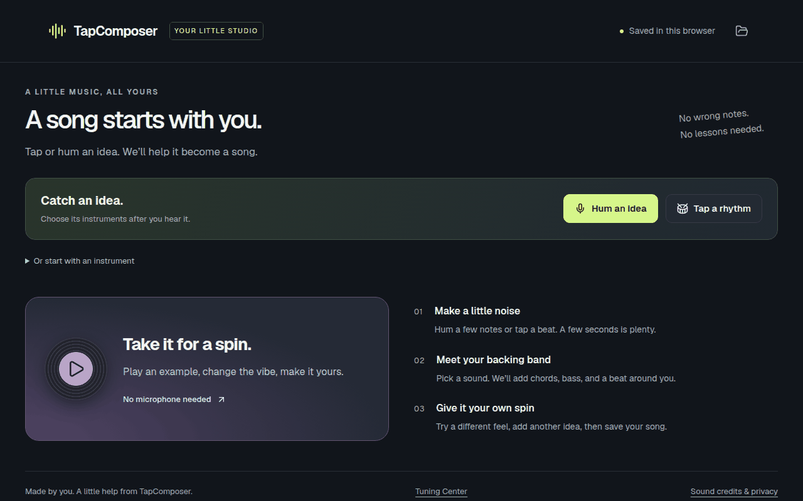
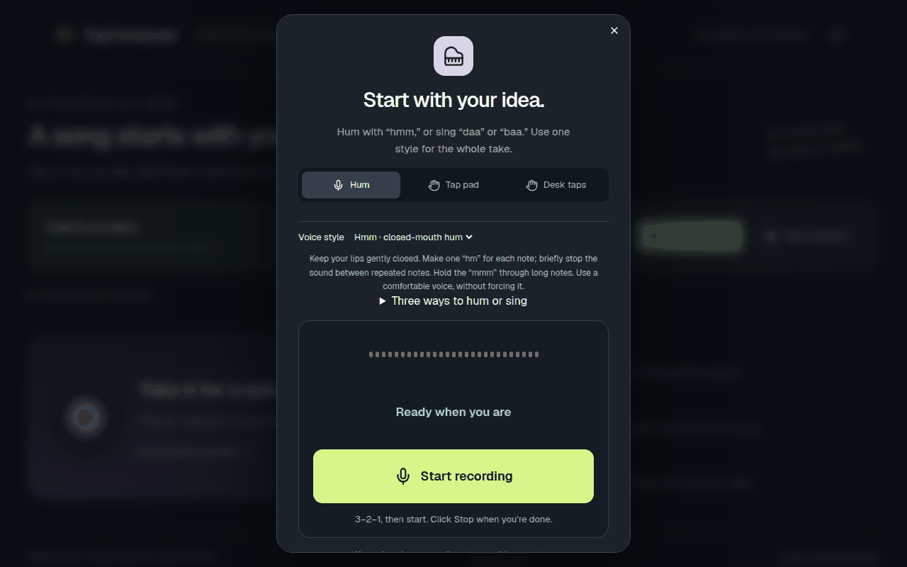
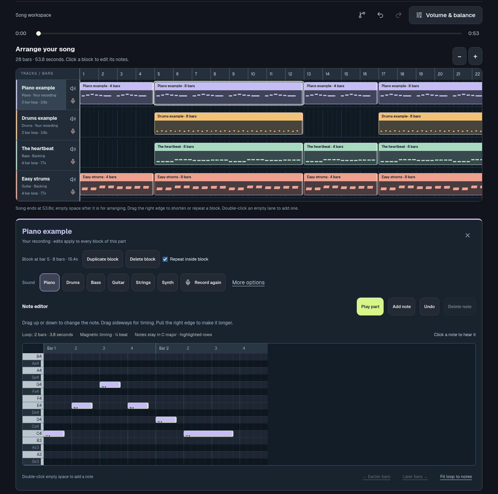
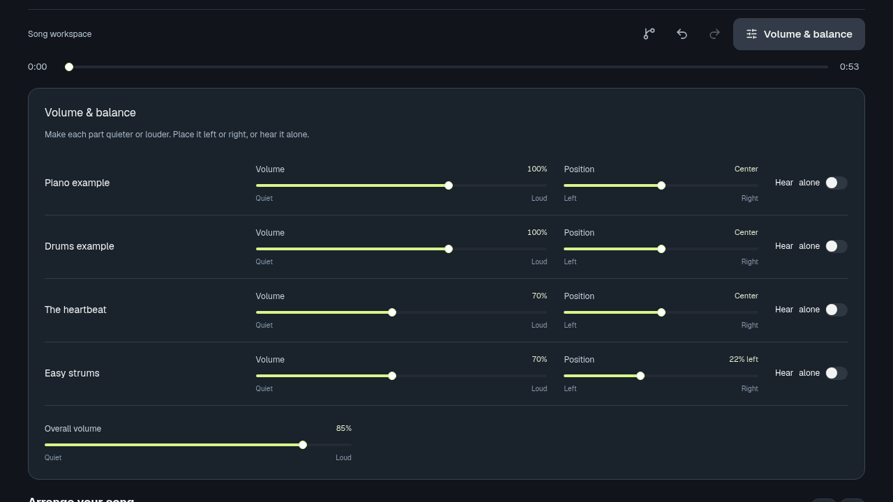
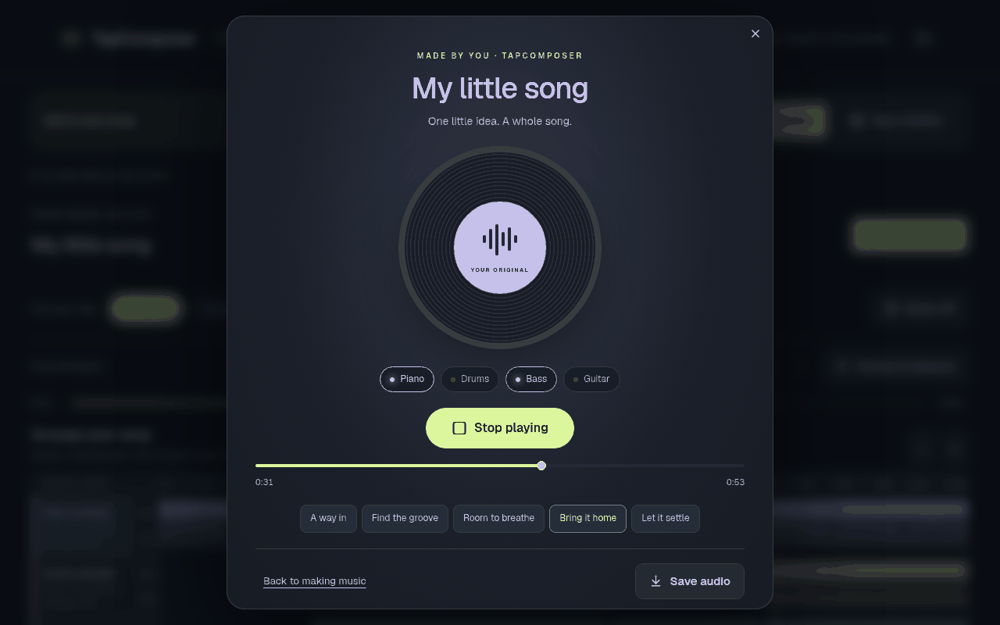
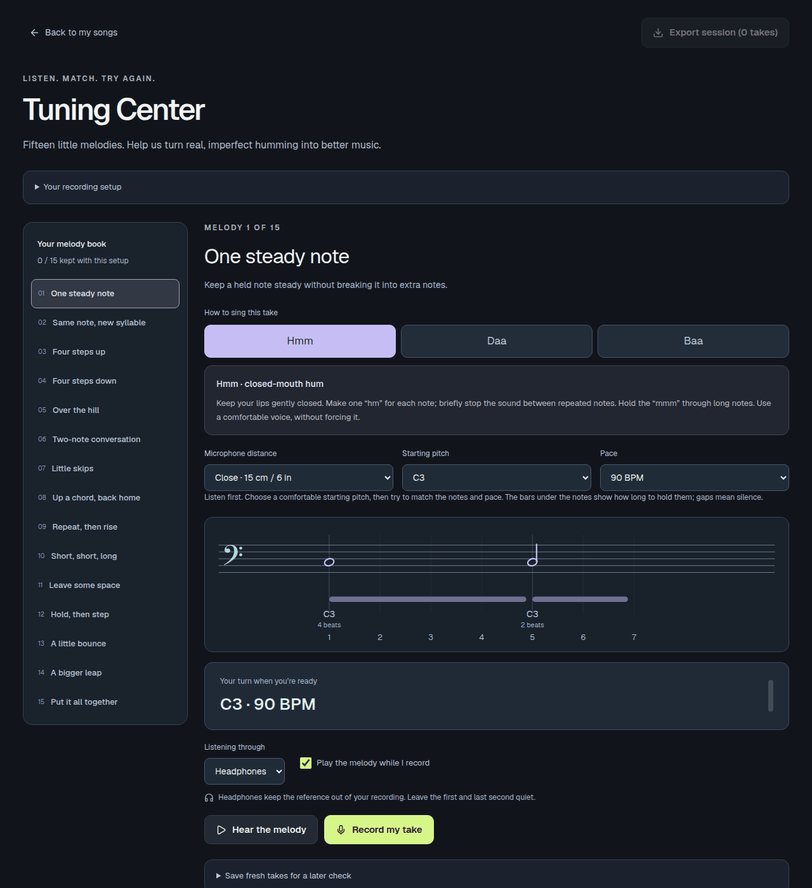
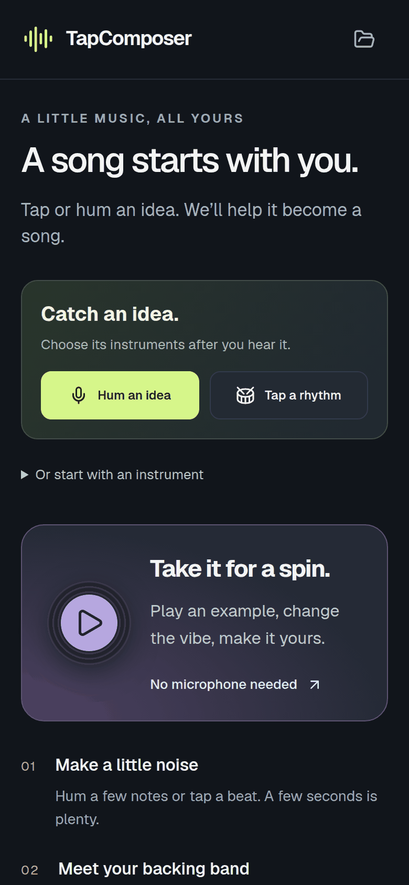
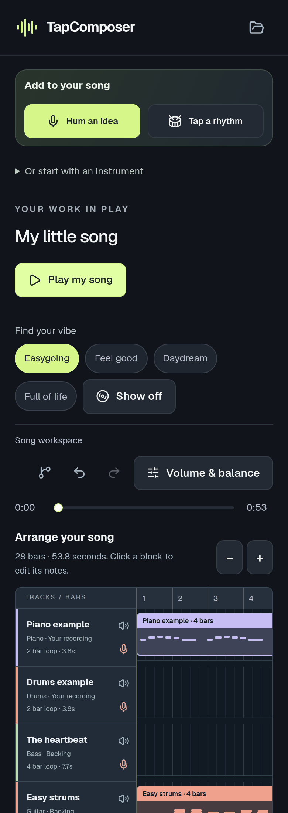

# TapComposer: hum or tap a melody, get a full song

**TapComposer is a free, browser-based music maker that turns a hummed melody or tapped rhythm into an editable multi-track song, with automatic backing, a clip playlist and a piano roll.** It transcribes humming to notes on-device with a neural pitch tracker (CREPE Tiny on ONNX Runtime Web), arranges chords, bass and drums around your idea, and exports WAV, MP3 or MIDI. No account, database or hosted service is needed for the core app.

<p align="center">
  
</p>

## Why TapComposer

Most DAWs ask you to know music theory before you can get an idea down. TapComposer starts from the idea instead: hum a few notes or tap a beat for a few seconds, pick an instrument, and it builds a five-section song around it. The result is not a locked render. You get a FL Studio-style playlist and piano roll to adjust it, and your original recording is always kept.

- **Hum to MIDI-style notes, locally.** Pitch tracking and note segmentation run in your browser; recordings are not sent anywhere in the free mode.
- **Automatic arrangement.** Chords follow your melody; bass, drums and sections are generated and can be regenerated without losing manual edits.
- **Still editable.** Move clips, edit notes, change the instrument, pin the parts you like.
- **Export what you made.** Stereo WAV, 192 kbps MP3, MIDI, or an editable project file.

## Features

- **Two ways in:** hum (with a selectable *Hmm*, *Daa* or *Baa* voice style) or tap a rhythm on a pad or on your desk. Every input works with every instrument.
- **Six instruments:** piano, drums, bass, guitar, strings and synth. Switch an idea's instrument after recording without re-recording it.
- **One-click song building:** backing is added automatically and arranged into five sections. **Find your vibe** switches between four backing styles (Easygoing, Feel good, Daydream, Full of life) while the song plays, and Undo brings the previous arrangement back.
- **Playlist and piano roll:** drag clips, resize or repeat them, click a bar number to play from there. The note grid labels pitches, keeps new notes in the song's key, snaps timing to quarter beats, and has named kick, snare and hi-hat rows for drums.
- **Mixer:** per-part volume and stereo position, *Hear alone*, and an overall volume.
- **Layering and retakes:** layer several instruments from the same recording, or re-record a single track while keeping its name, mix and placement. Undo restores the old take.
- **Pins:** keep a part, a section or the harmony fixed against automatic changes.
- **Listening view:** **Show off** opens a focused player with a spinning record and instrument lights that follow the actual notes.
- **Export and portability:** WAV, MP3 (encoded in a worker), MIDI and project backups that include original audio. Songs autosave to IndexedDB; undo/redo keeps up to 50 edits.
- **Keyboard and touch friendly:** Space, Ctrl/Cmd+Z, Ctrl/Cmd+S and arrow-key editing of blocks and notes; responsive layout for phones.
- **Tuning Center (`/tuning`):** 15 guided melodies for recording and comparing real humming against the detector.
- **Optional Premium studio finish:** renders the arrangement through a local ACE-Step XL GPU service. This needs separate configuration and is off in the default and Docker setups.

Limits: 24 parts, 30 seconds per take, 12 sections and 512 beats of arrangement.

## Screenshots

All images are captures of the running app using its built-in example song. The microphone steps are shown at their ready state only, because capture quality depends on a real microphone.

| | |
| --- | --- |
| <br>Start screen: hum, tap, or play the no-microphone example. | <br>Recorder: hum, tap pad or desk taps, with a 3-2-1 countdown. |
| <br>Piano roll: pitches are labeled and edits stay in the song's key. | <br>Mixer: volume, stereo position and solo for every part. |
| <br>Show off: a listening view with section shortcuts and downloads. | <br>Tuning Center: 15 guided melodies for evaluating humming recognition. |

On a phone, the same studio reflows to a single column:

<p align="center">
  
  &nbsp;&nbsp;
  
</p>

## Quick start

Requires Node.js 22.15+ and npm.

```sh
git clone https://github.com/dashw00d/TapComposer.git
cd TapComposer
npm ci
npm run dev
```

Open http://localhost:3000 and press **Take it for a spin** to play an editable example immediately, no microphone needed. To hum or tap, click **Hum an idea** or **Tap a rhythm** and allow microphone access.

Other commands:

```sh
npm run check   # strict TypeScript, lint and 117 automated tests
npm run build   # production build
npm start       # serve the production build on 127.0.0.1:3000
```

Microphone capture requires HTTPS or localhost plus browser permission. Headphones reduce bleed when recording over existing parts. The local server reads an optional `.env.local` (see `.env.example`); nothing in it is needed for the free composer. The app binds to loopback only (`127.0.0.1`). For the optional Premium studio finish, the configured GPU services can be started with `systemctl --user start tapcomposer-ace tapcomposer-gateway`; both inference services also bind only to loopback (see [inference/README.md](./inference/README.md)).

### Docker

```sh
docker build -t tapcomposer .
docker run --rm --name tapcomposer -p 127.0.0.1:3003:3000 tapcomposer
```

Then open http://localhost:3003. More deployment notes are [below](#docker-and-self-hosting).

## Tech stack

Next.js-style App Router on [Vinext](https://github.com/cloudflare/vinext) (Vite), React 19, TypeScript, Tailwind CSS 4, Web Audio, ONNX Runtime Web (CREPE Tiny pitch model), IndexedDB, and a bundled `lamejs` MP3 encoder. Tests run with `tsx --test` and Testing Library.

## Usage guide: making a song

New here? **Take it for a spin** plays an editable example immediately, without a microphone. **Find your vibe** switches between four backing styles while the song plays; Undo brings the previous arrangement back. **Show off** opens a focused listening view with a spinning record, instrument lights following the actual notes, section shortcuts, and audio downloads. Reduced-motion preferences keep the record still.

1. Start with **Hum an idea** or **Tap a rhythm**, then audition piano, drums, bass, guitar, strings, or synth. Expand the instrument drawer to choose a sound before recording. Every instrument accepts every input.
2. For humming or desk taps, click **Start recording**. The microphone and sounds prepare first; a visible **3–2–1 → Start** countdown leads into capture. Click **Stop recording** when finished, or cancel during the countdown. Capture and backing share an audio-clock start, and leading silence stays part of the take. Hear an interpretation, retry or smooth it, then keep it. Optional controls layer several instruments from the same recording and audition them with the song. The first idea establishes a pulse and provisional key. Taps become chords, bass movement or a melody according to the chosen instrument.
3. Keeping an idea automatically creates complementary backing and a five-section song. A hummed melody informs the harmony; your original performance and recording remain available.
4. Use the microphone button beside any track, or **Record again** beside its sound choices, to retry just that part. The recorder remembers how you entered it. Listen to the new take, then choose **Keep new take** or **Keep current take**. Replacement preserves the track’s name, mix, and placement and leaves the rest of the song untouched; Undo restores the old take.

   The playlist shows tracks down the left and bars across the top. Drag colored blocks to move them; pull their right edge to shorten or repeat them. Click a bar number to play from there. Select a block to duplicate or delete it, or double-click an empty lane to add one. Deleting a block keeps its source part available.
5. Click a block or track name to open its notes underneath. The grid labels every pitch (C, D, F♯ and so on). New notes and vertical edits stay in the song’s key; timing lands on a magnetic quarter-beat grid. Recorded accidentals remain intact when only timing changes. Drag notes vertically for pitch and horizontally for timing; pull the right edge for length. Double-click empty space to add a note. Drums have named kick, snare and hi-hat rows. Select a note and press **Delete note** to remove it. **Trim empty edges** removes leading and trailing silence from the editable part. These edits apply to every block of that part; original audio and musical intent remain intact.
6. Choose **Sound** beside the notes to change the instrument, including automatic backing such as Warm chords. Manual note edits stay protected through sound changes and automatic composition. **More options** contains musical directions, renaming, copying a part, replacing its recording and removal. **Volume & balance** reveals labeled volume and position sliders with live values, Hear alone, and overall volume. Hear alone selects one part at a time. **Song settings** contains feel, backing intensity, tempo and harmony protection. **Try another version** previews changed backing before you keep it; manually placed blocks stay in place.
7. Play, seek and repeat the song. Save the full arrangement as stereo WAV, 192 kbps MP3, or MIDI. Download a project backup to move an editable song, including original audio and manually placed blocks, to another browser.

8. In Premium, give the song a studio finish. Add optional direction, choose how closely it follows the arrangement, then make a take. Compare the editable arrangement and saved takes at a shared playback position with RMS listening levels matched by attenuation, save WAV, or keep arranging and render again. Up to three takes survive browser saves and editable project backups. Free mode keeps all local tools and makes no audio uploads.

**Keep** pins a part, a section (including its shared parts), or harmony against automatic changes. Direct manual edits remain available. Keeping editable parts does not guarantee identical notes in the separate ACE-Step finished mix. **Save another direction** creates a separate editable song with its source recordings and studio takes; both remain in the local library.

The app supports 24 parts, 30 seconds per take, 12 sections and at most 512 beats of arrangement. These are resource limits rather than setup choices. Songs autosave locally; undo/redo retains up to 50 edits. Existing two-instrument songs retain their patterns and recordings and can be expanded with **Build my song**.

Keyboard in the playlist: left/right arrows move a selected block by a beat; Shift plus arrows resize it; Delete removes it. In the note grid, arrows change pitch or timing, Shift plus left/right changes length, and Delete removes a note. Each drag is one undo step.

Keyboard: Space plays/stops when focus is outside an interactive control; Ctrl/Command Z undoes; Shift Ctrl/Command Z redoes; Ctrl/Command S downloads a project backup; Escape stops playback. Dialogs, sliders and recording controls support keyboard interaction. Slider thumbs have explicit accessible names and spoken values; mixer and song-setting gestures each commit one undoable musical change. Seeking controls playback, and studio interpretation controls the next render.

## Tuning Center

Open `/tuning` (also linked in the composer footer) for 15 guided melodies, explained Hmm/Daa/Baa styles, microphone-distance tracking, reference playback, recording and rerecording, local session saves, and clean/noisy detector comparisons. Export your recordings for reproducible evaluation with `npm run voices:lab`. See [TUNING_CENTER.md](./TUNING_CENTER.md) for the recording protocol and scoring workflow.

## Architecture

Free mode runs music processing on the device. Premium adds ACE-Step XL cover rendering through the local GPU gateway. Both experiences are tested locally; the Premium label represents the future product tier. Account billing is not implemented. See [inference/README.md](./inference/README.md) for the GPU service, configuration, limits and operational requirements.

| Module                                             | Responsibility                                                                             |
| -------------------------------------------------- | ------------------------------------------------------------------------------------------ |
| `public/worklets/capture.js`                       | Audio-clock capture, meter, explicit start, 30-second cap; no microphone monitoring        |
| `lib/music/capture.ts`                             | Permission, cancellation, original WAV preservation, analysis worker                       |
| `lib/music/neural.ts`                              | CREPE Tiny inference, voice resampling, confidence filtering and melodic segmentation      |
| `lib/music/analysis-client.ts`                     | Warm worker reuse, progress, cancellation and bounded fallback                             |
| `lib/music/analyze.ts`                             | YIN fallback, shared note segmentation and adaptive tap onset detection                    |
| `lib/music/resolve.ts`                             | Pulse/key estimates, soft correction and instrument-specific interpretation                |
| `lib/music/harmony.ts`                             | Melody-weighted diatonic harmony                                                           |
| `lib/music/composition.ts`                         | Backing, feel/variation, section structure, tempo scaling and shared arranged event stream |
| `lib/music/audio.ts`                               | Samples, drum/synth DSP, audio-clock scheduling, stereo mix, effects and offline rendering |
| `lib/music/export.worker.ts`                       | MP3 encoding away from the interface thread                                                |
| `lib/music/project.ts`, `midi.ts`                  | Validated editable project backup/import and portable MIDI                                 |
| `lib/music/storage.ts`                             | IndexedDB songs/original audio and migration of source tempo                               |
| `hooks/use-song-history.ts`                        | Snapshot undo/redo retaining original audio by reference                                   |
| `components/song-timeline.tsx`, `note-cleanup.tsx` | Interactive clip playlist, piano roll and drum rows                                        |
| `lib/music/clips.ts`, `cleanup.ts`                 | Bounded arrangement and note edits preserving source recordings                            |
| `components/recorder.tsx`                          | Capture and take review                                                                    |
| `components/composition-panel.tsx`                 | Automatic composition, optional section arrangement and balance                            |
| `components/composer.tsx`                          | Studio, transport, library, instrument changes and export                                  |

The `MusicalIntent` layer separates human input from instrument performance. Tempo changes scale playback without rewriting source timing. Playback, WAV/MP3 and MIDI use the same arrangement, section membership and mix choices. Section fades use continuous Web Audio gain envelopes; MIDI approximates them with CC11 expression at quarter-beat intervals. Regeneration replaces suggested backing while retaining original ideas and manual structure.

Humming uses a pretrained CREPE Tiny neural pitch tracker, executed locally by ONNX Runtime Web in the analysis worker. The model and runtime load when the humming recorder opens and remain warm between takes. Relative sound-level gates identify syllable boundaries, even when pitch stays the same. Shared segmentation bridges brief voiced confidence dropouts and waits for a sustained pitch change before starting a new note, without shifting the confirmed onset. Breaths, unvoiced consonants, and deliberate short notes stay separate. Model loading, unsupported devices and slow inference fall back to YIN; capture and cancellation remain available. Tapping continues to use onset detection. The immediate composer uses local chord scoring and instrument rules. Premium then renders the actual arrangement with ACE-Step XL, preserving tempo/key conditioning and editable source parts. See [MODEL_EVALUATION.md](./MODEL_EVALUATION.md) for the evaluated alternatives and limitations.

The 1.96 MB CREPE model is bundled under `public/models`; the pinned 14 MB WASM runtime and loader are copied locally by `predev`/`prebuild`. No model or recording request goes to Hugging Face at runtime. `node scripts/download-models.mjs` restores missing weights and verifies their SHA-256 checksum.

Four sample banks are bundled locally: grand piano, electric bass, acoustic guitar and violin-based strings, about 3.3 MB in total. Drums and synth are generated. No third-party sound CDN is required during playback. Assets must load first; an installable, offline-cached PWA is not included.

## Docker and self-hosting

```sh
docker build -t tapcomposer .
docker run --rm --name tapcomposer -p 127.0.0.1:3003:3000 tapcomposer
```

Open http://localhost:3003 for a local container check. The image builds the app and bundles its pitch model, WASM runtime, samples, and capture worklet. It listens on port 3000 and includes an HTTP health check. Local environment files and tuning recordings are excluded from the image.

On ServerChirp, use the Container stack with this repository's `main` branch, build context `.`, `Dockerfile`, and a primary HTTP port of 3000. Route `tapcomposer.dashwood.net` to the server and enable HTTPS so microphone recording works. Push-to-deploy rebuilds the container after GitHub pushes.

ServerChirp's default proxy header blocks microphones. On BigBoy, the small `deploy/tapcomposer-microphone.path` service watches this app's generated Nginx file and runs `deploy/allow-microphone.py` to keep `microphone=(self)` after deployments and certificate updates. It validates Nginx before reloading. The script is installed at `/usr/local/lib/tapcomposer/allow-microphone.py`, and the two units are installed in `/etc/systemd/system` with the path unit enabled. This adjustment is specific to this app's ServerChirp ID; update the paths if recreating the app. Verify `Permissions-Policy` and a recording after changing the proxy configuration.

No database, volume, or GPU service is required for the composer and Tuning Center. Songs and recordings stay in each browser; use project downloads to move songs between devices. The optional Premium GPU service requires separate configuration; the Docker deployment defaults to the local browser tools.

## Verification and practical limits

`npm run check` runs strict TypeScript, application lint, and automated engine, persistence, audio and component interaction tests. Coverage includes pitch/noise/tap fixtures, all instrument/input combinations, automatic structure and variations, preservation of manual edits, tempo scaling, entrances/repeat/register, seek/repeat scheduling, backup import validation, MIDI, undo, original-audio persistence, sample decoding, bounded stereo rendering and WAV/MP3 decoding. Additional coverage exercises pins, directions, independent branches, layered source retention, fade envelopes in real audio, comparison position across rapid switches, and discard/retry/accept/undo in the complete composer. Component tests run in jsdom with the same Vinext link alias used by the application. Production output is built and checked through HTTP requests.

The untouched generated Shadcn catalog and its generated mobile hook are excluded from application lint because of upstream lint violations. They remain typechecked; application code and tests are linted.

Automated verification does not establish subjective musical quality or microphone behavior across real devices. Humming is monophonic; pitch ambiguity, noisy rooms, breathy voices and speaker bleed can reduce accuracy. Device input/output latency is not calibrated automatically; headphones avoid speaker bleed, and microphone capture requests echo cancellation, noise suppression and automatic gain control off to preserve musical attacks. Beatboxing sound classification, polyphonic transcription, arbitrary audio imports and professional plugin hosting are not implemented. Device microphone, touch-browser and screen-reader evaluation remain valuable user testing.

Songs live in this browser's IndexedDB. Clearing site data or switching origins does not carry songs over. Use **Save project** and **Open project** to preserve or transfer editable songs. Storage failures remain visible, and original recordings can be downloaded separately.

For a measured view of humming accuracy, [MODEL_EVALUATION.md](./MODEL_EVALUATION.md) and [VOICE_EVALUATION.md](./VOICE_EVALUATION.md) report that across 40 annotated recordings the current detector averages about 94.7% frame pitch recall but only 68.3% pitch-and-onset note F1 at 100 ms. In other words, pitches are usually found, but note boundaries from real, imperfect humming are still the hard part. That is why the Tuning Center exists.


## Regenerating the screenshots

`scripts/capture-screenshots.mjs` drives a running instance with Playwright and writes `docs/screenshots/`; `scripts/optimize-screenshots.py` shrinks the PNGs. See the comments at the top of each script for usage.

## Documentation

[IMPLEMENTATION.md](./IMPLEMENTATION.md) (scope and acceptance checklist), [TUNING_CENTER.md](./TUNING_CENTER.md) (recording protocol), [MODEL_EVALUATION.md](./MODEL_EVALUATION.md), [VOICE_EVALUATION.md](./VOICE_EVALUATION.md), [UX_REVIEW.md](./UX_REVIEW.md) and [inference/README.md](./inference/README.md) (optional GPU service).

## License

No license file is currently included in this repository, so all rights are reserved by default. Bundled sounds, models and the MP3 encoder carry their own attributions; see [THIRD_PARTY_NOTICES.md](./THIRD_PARTY_NOTICES.md).
